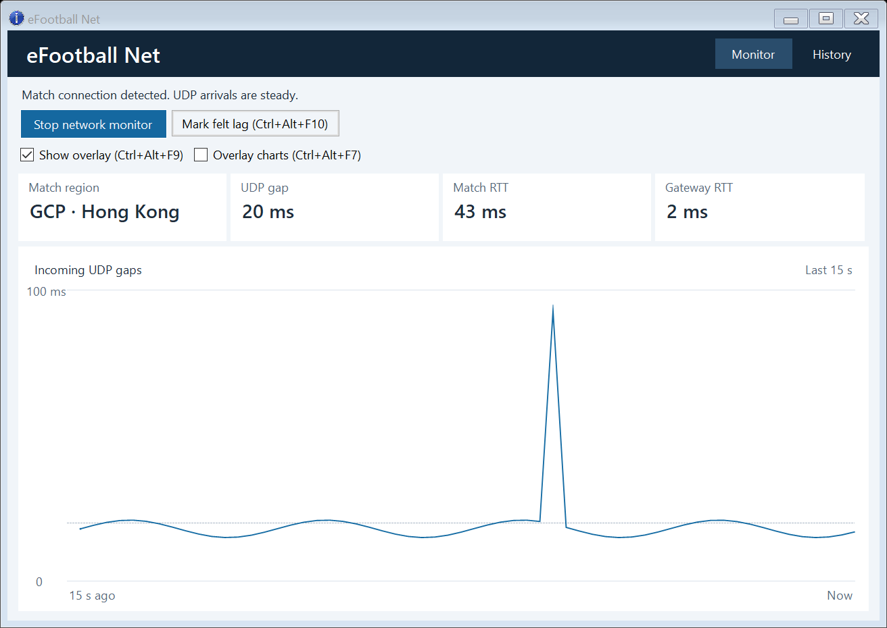

# eFootball Net

Windows network monitoring for eFootball, with a live overlay, session history, and comparisons.

[Download the latest release](https://github.com/shariski/efootball-net/releases/latest)

## Get started

1. Extract the Windows x64 ZIP and open `eFootballNet.exe`.
2. Click **Start network monitor** and accept the Windows permission prompt.
3. Play in windowed or windowed fullscreen mode. Open **History** to review or compare sessions.

**Ctrl+Alt+F9** toggles the overlay. **Ctrl+Alt+F10** marks felt lag. The panel shows the shortcut for overlay charts.

[Usage guide](docs/usage.md) · [Build instructions](docs/build.md) · [Changes](CHANGELOG.md) · [License](LICENSE)
