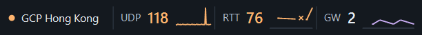

# GameDesk for Windows

See how the connection behaves alongside eFootball, mark the moments you feel delay, and compare the recordings afterward. GameDesk is a native Windows tray app built with .NET and Windows Forms.

[Download the Windows x64 release](https://github.com/shariski/gamedesk-windows/releases/latest)

## Get started

1. Extract the release ZIP and open `GameDesk.exe`. The standard package includes its .NET runtime. The smaller **slim** package uses the [x64 .NET 10 Desktop Runtime](https://dotnet.microsoft.com/download/dotnet/10.0).
2. Open eFootball and choose **Start network monitor** in GameDesk. Accept the Windows administrator prompt for the ETW collector.
3. Play in **Windowed** or **Windowed Full Screen** mode. Enable **Show in-game overlay** or press **Ctrl+Alt+F9**. The overlay attaches to the top-right edge of the display showing eFootball.
4. Press **Ctrl+Alt+F10** when you feel lag. Open **Session review** after playing and use **Jump to** to inspect that time.

GameDesk was exercised on Windows 10 22H2 x64 and is built for current Windows x64 systems. Use a [Windows version supported by .NET 10](https://learn.microsoft.com/dotnet/core/install/windows#supported-versions) for regular use. The portable release has a SHA-256 checksum.

## Overlay and review

- **Compact overlay** shows the estimated provider region, UDP arrival gap, match RTT, and gateway RTT in milliseconds. Orange highlights a detected UDP spike, an RTT rise from its recent baseline, or a probe timeout.
- **Detailed overlay** adds three aligned 15-second charts. Toggle it with the shortcut shown in the control panel, usually **Ctrl+Alt+F11** or **Ctrl+Alt+F7**. Use **Ctrl+Alt+F9** for a hidden overlay while logging continues.
- **Session Review** displays UDP gap peaks, ICMP RTT, and markers on one elapsed timeline. Choose a spike, **Felt lag** marker, or time on the chart to inspect nearby samples.
- **Compare with** adds a second session. Blue identifies the primary session and dashed orange identifies the reference. The charts and statistics use the elapsed-time range shared by both recordings.

GameDesk uses bidirectional UDP activity to select a candidate game connection. Arrival gaps reflect sending cadence and conditions along the path. RTT uses ICMP probes at roughly two-second intervals, and missing replies remain missing values. Provider regions come from published IP ranges. **Global edge** represents a global prefix. These signals help locate an event in time, and connection type and match phase can affect comparisons.

GameDesk starts its network trace when eFootball is detected. The overlay preference is saved locally. Closing the control window leaves the tray app open. Use **Exit** from its tray menu to close the app.

## Documentation

- [Measurements, troubleshooting, and local data](docs/usage.md)
- [Build, test, and package GameDesk](docs/build.md)
- [Release history](CHANGELOG.md)
- [License and third-party sources](THIRD-PARTY-NOTICES.md)
- [Security reports](SECURITY.md)

Independent community project for players of eFootball, a trademark of Konami Digital Entertainment.
