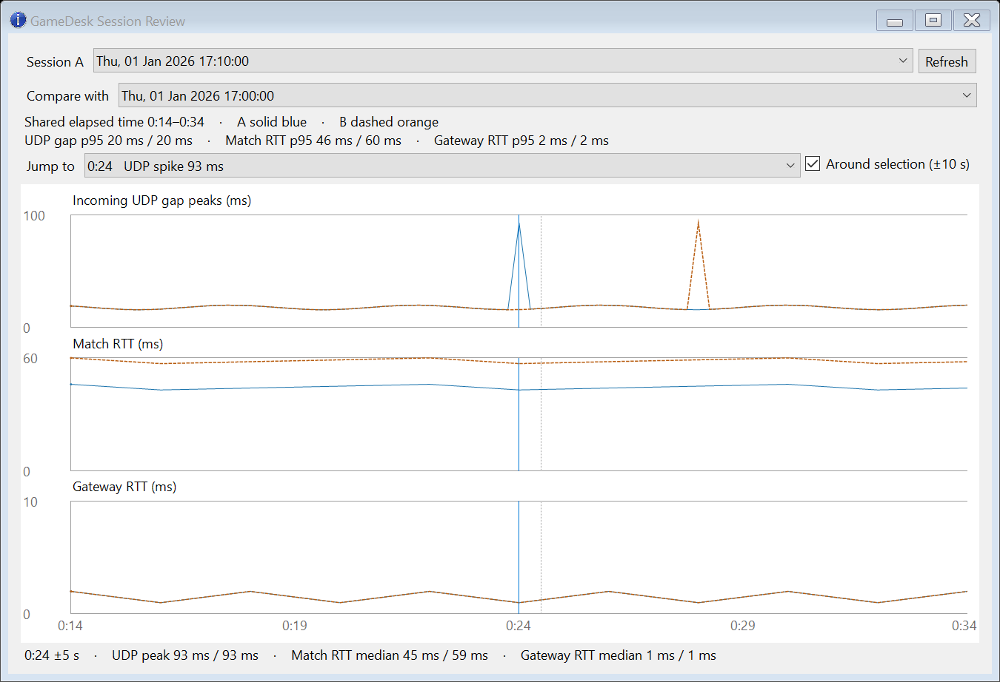

# Use GameDesk

## Read the overlay

| Display | What it measures |
| --- | --- |
| Provider and region | An estimate from the candidate endpoint's IP prefix. Global prefixes are labeled **Edge**. |
| **UDP** | The typical observed time between incoming packets. A detected gap spike replaces the usual value temporarily. |
| **RTT** | ICMP round-trip time to the candidate endpoint. |
| **GW** | ICMP round-trip time to the default gateway on the game connection's local interface. |
| **×** | A probe timed out. |
| **—** | A value is unavailable or stale. |

Orange means a signal needs attention. For RTT, GameDesk compares against at least three earlier replies and highlights a rise of at least 40% with a minimum difference of 15 ms for the endpoint or 5 ms for the gateway. Historical graphs use successful replies and break across missing samples. Use the live charts to compare timing between the signals. Each chart uses its own vertical scale.

## After a match

Open **Session review** from the panel or tray. Each session begins when the app finds a candidate flow and opens a log. Session elapsed time can include loading or post-match traffic. Use **Jump to** for a flagged gap, the largest recorded gap, or a **Felt lag** marker. The detail row summarizes the five seconds before and after the selected time. **Around selection** constrains the charts to the nearby time window. Arrow keys move the time cursor when the charts have focus.

In **Compare with**, choose a second session. GameDesk compares the shared elapsed range up to the end of the shorter recording. The summary uses per-bucket UDP peak values for its p95, and successful replies for RTT. A change in the destination, the game mode, or the connection conditions can change the result.

## Troubleshooting

- **Waiting for eFootball** means the monitor has started and is looking for `eFootball.exe` in your desktop session.
- **Waiting for match traffic** is expected in menus or before the bidirectional flow has enough samples.
- **Overlay hidden** can be toggled with **Ctrl+Alt+F9** or from the control panel. The panel shows the hotkeys Windows allowed the app to register. Use its checkbox if another application has the shortcut.
- **No marker** can occur if **Mark felt lag** is used before GameDesk has opened a session log. The button becomes available during a detected session.
- **Frame pacing changes** can be investigated by comparing the same game scene with the overlay hidden, compact, and detailed. The hidden mode keeps the logger active. [PresentMon](https://github.com/GameTechDev/PresentMon) can capture frame times external to GameDesk.
- **Windows launch warning** can appear on the unsigned release. Verify the download against the published checksum, or build the application from source.

## Local data

Session files are written to `%LOCALAPPDATA%\GameDesk\sessions`. The tray's **Open session logs** entry opens that folder. Logs contain timestamps, endpoint addresses, arrival-gap metrics, ICMP probe results, and markers. The collector reads UDP/IP event metadata, while the app saves derived readings.

The program reads its provider table from the release package. Its network activity consists of sending ICMP probes to the selected match endpoint and to the interface gateway. Session files and overlay settings stay on your computer. Close the monitor before deleting active logs. Remove any endpoint addresses and other private details before sharing diagnostic files.
